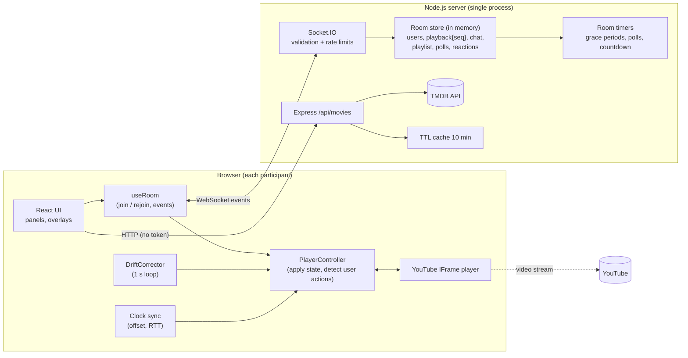

# Watch Party: Technical Report

All measurements in this report come from the files in [`docs/evidence/`](evidence/), produced by `loadtest/all.js` on 2026-10-12 against the current code. Nothing is estimated. Where something was not measured, it says **NOT MEASURED**.

---

## 1. Overview and features

Watch Party lets a group watch YouTube videos together with synchronized playback and shared discovery. There are no accounts: create a room, share the link.

| Area | Feature | Extra? |
|---|---|---|
| Rooms | 6-character codes without 0/O/1/I, invite links, name prompt for direct links, persistent identity across refreshes, room lock, max 50 members | |
| Playback | Synchronized play/pause/seek from anyone (or host-only mode), late-join snapshot, auto-rejoin after reconnect | |
| Sync | NTP-style clock offset, sequence numbers, echo-loop prevention, **automatic drift correction** (soft rate + hard seek, learned seek latency) | |
| Social | Live chat (history, linkify, safe rendering), floating emoji reactions | |
| Decide | Shared playlist with votes, drag-and-drop order, auto-advance; group polls with timers and anonymous tallies | |
| Discover | TMDB categories, genre/year/rating filters, infinite scroll, Fuse.js fuzzy search, trailers to the playlist, movie suggestion cards in chat | |
| Host | Host transfer, kick (10 min ban), control mode, chat toggle, room lock, end party | |
| **A** | **Timestamped reactions**: emoji markers on a timeline, clustered in 5 s buckets; crossing a bucket replays the crowd faintly for latecomers | ★ creative |
| **B** | **Catch me up**: one-click hard sync, and an automatic suggestion after 3 failed corrections | ★ creative |
| **C** | **Live sync dashboard** (host): per-person drift sparklines (plain SVG), RTT, connection quality, worst person highlighted | ★ creative |
| **D** | **Watch-together stats**: watch time, reactions, most-reacted moment (host can jump the room there), poll results, top chatter; shown to everyone when the host ends the party | ★ creative |
| **E** | **Spoiler-safe chat**: messages starting with `\|\|` stay blurred until clicked (per-user toggle) | ★ creative |
| **F** | **Co-pilot countdown**: "Starting in 10…" rendered from one shared server timestamp, so every screen flips together and playback starts at 0 | ★ creative |
| Extra | "Skip this video?" quick poll (majority of connected people), "What next?" poll from the playlist, "vote on the latest suggestions" poll, Sync Health panel (H), debug panel (D) with drift injection and simulated disconnects, downloadable drift log | ★ |
| UX | Dark/light themes, responsive down to 360 px, unread badges, toasts, keyboard shortcuts, ARIA labels, error boundaries | |

## 2. Architecture



- **Client** (React + Vite): `useRoom` owns the session (join, rejoin after every reconnect, all room events). `PlayerController` is a framework-free class that bridges the YouTube player and the authoritative state. `DriftCorrector` is a framework-free class shared with the load-test bots.
- **Server** (Express + Socket.IO, ES modules): one handler file per feature. Every handler goes through a wrapper that rejects non-object payloads, catches exceptions and routes failures to the ack or an `action:error` event. Room mutations are synchronous and run through `runInRoom()`, and async I/O (oEmbed, TMDB) happens before entering it.
- **Data flow for an action:** the user clicks pause, the controller detects it and emits `playback:action`, the server validates, increments `seq`, stamps `updatedAt`, and broadcasts `playback:state` to everyone (sender included). Each client drops it if `seq` is stale, otherwise computes the expected position and aligns its player.
- **Movies:** the browser only calls our `/api/movies/*`. The server adds the bearer token, caches for 10 min, rate limits per IP and times out after 5 s.

## 3. Synchronization design

**Server-authoritative state.** Per room: `playback = { videoId, playing, position, updatedAt, seq, lastActionBy }`, where `position` is the video time that was true at server time `updatedAt`. Clients never trust each other, only the latest `seq` from the server.

**Clock offset** (`client/src/utils/clockSync.js`). On every connect, and every 20 s, the client sends 8 `time:ping` messages 100 ms apart. For each one: `rtt = t1 − t0`, `offset = ts − (t0 + rtt/2)`. The worst 25 % by RTT are dropped, and the offset is the **median of the best half**. A single lowest-RTT sample can still be badly asymmetric (its error is up to rtt/2), while the median of several good samples resists one outlier. Changes under 20 ms are ignored to avoid jitter. All timing uses one monotonic clock (`performance.timeOrigin + performance.now()`), and `serverNow() = clientNow + offset`. Unit tests simulate asymmetric links. Measured offsets between bots on the same machine were at most 0.8 ms (evidence files, `perClient.clockOffsetMs`).

**Expected position:** `expected = playing ? position + (serverNow() − updatedAt)/1000 : position`. A late joiner, a reconnecting client and a normal client all use this same formula.

**Sequence numbers.** Every accepted change does `seq++`. Clients ignore any state with `seq ≤ lastApplied` (duplicates and out-of-order), except a fresh join snapshot. The load tests counted **0 out-of-order, 0 gaps, 0 duplicates** in every run.

**Echo-loop prevention** (`client/src/sync/playerController.js`). Applying a remote state makes the iframe fire `onStateChange`, which must not be re-sent. There are three layers:
1. **Compare to the room state.** PLAYING is only reported when the room is paused, PAUSED only when it is playing. Whatever we do to match the room can never look like a user action.
2. **Command attribution.** Every play-type or pause-type command we issue is timestamped. A PLAYING/BUFFERING event within 1 s of our own play command (or PAUSED after our own pause) is ours, and the attribution is consumed or superseded once used. Programmatic seeks record their *target*, and a jump landing there is ours. A click right after a remote update is therefore still recognised as the user's. The first version used a blanket 800 ms "ignore everything" window, and the e2e test showed it swallowed real clicks (see §8).
3. **Reconcile.** After every applied state or attributed event, the player is re-checked against the latest room state and any mismatch is fixed (at most 3 passes), so a tab can never silently stay diverged.

The e2e test verifies **one click = exactly one `seq` increment**, and 12 rapid conflicting clicks from two tabs converge to one state.

**Seek detection.** The YouTube API has no "seeked" event, so every 250 ms the controller predicts the position (advancing only while PLAYING) and treats a jump over 1 s as a user seek, unless it lands on our own programmatic target. A PAUSED event is deferred 200 ms, because it may be the start of a scrub.

**Late join and reconnect.** `room:join` is idempotent per `userId`: a known user is rebound to the new socket and keeps host status, with no "joined" message. The ack carries a full snapshot (playback, users, settings, last 50 chat messages, playlist, polls, reactions, countdown), and the server also emits `playback:state` to that socket. On every `connect`, the client first re-runs clock sync and then rejoins. Socket.IO connection-state recovery (2 min) is enabled as a bonus, but correctness relies on the explicit rejoin. A disconnected user is greyed out and removed after 60 s. A disconnected host keeps the crown for 15 s and then it moves to the longest-connected member. A duplicate tab gets `session:replaced`.

**Autoplay.** If the room is playing but the player is not, 1.5 s after a play command, a **"Click to join playback"** overlay appears. The click is a user gesture, so playback starts at the room position.

## 4. Drift detection and correction

Every 1 s while the room is playing (`client/src/sync/driftCorrector.js`, constants in `syncConfig.js`):

1. Skip if the player is buffering, unstarted, cued or ended, or if less than **1.5 s** has passed since a seek or play (don't fight buffering).
2. `drift = currentTime − expected` (positive = ahead), smoothed over the last **3** samples. A single sample ≥ **0.5 s** off bypasses the average: it is a real step (a stall or a missed seek), not noise.
3. Decide:

| \|drift\| | Action | Reasoning |
|---|---|---|
| < 0.15 s | none (restore 1× if a soft correction was running) | inaudible, invisible |
| 0.15 – 0.5 s | **soft**: 1.05× when behind, 0.95× when ahead, until < 0.1 s | no visible jump. 50 ms corrected per second, so at most ~7 s |
| ≥ 0.5 s | **hard seek** to `expected + learned seek lead` | a soft correction from here would take too long (below) |
| no fine rates available | tolerate < 0.4 s, hard seek ≥ 0.4 s | the classic YouTube list `[0.25…2]` rounds 1.05 to 1, so soft is impossible, and 1.25× would be clearly audible |

4. After a hard seek: **3 s cooldown**, and the first clean sample afterwards updates a **learned seek lead** (moving average, 0–1 s), so later seeks aim ahead by the time the player needs to resume.
5. The player rate is forced back to the correction rate if someone changes the speed in the YouTube menu.
6. Every check goes into a 500-entry ring buffer (**Download drift log** in the D and H panels). The smoothed drift is reported every 5 s and broadcast to the room for the Sync Health panel and the host dashboard. After 3 hard corrections that don't stick, the user gets a "You're out of sync. Catch up?" toast.

**Deviation from the brief.** The brief suggested hard seeks only from 1.5 s. Soft correction at 1.05× removes 50 ms per second, so from 1.4 s it would need about 28 s and stay above the 500 ms target for about 18 s. We use 0.5 s so soft correction never exceeds the target. This was found while building the load test, and the unit tests document it.

## 5. Concurrency handling

- **Serial per room.** Node runs one handler at a time. Every mutation goes through `runInRoom()`, which is synchronous by contract (it throws if handed a promise), so a mutation and its broadcast can't interleave with another. Slow I/O happens before it, and state is re-checked afterwards (e.g. playlist duplicates after the oEmbed await).
- **Last write wins, everyone converges.** Each accepted action increments `seq` and is broadcast to everyone, including the sender, whose optimistic local state then yields to the server's.
- **Stale actions.** If the sender's `clientSeq` is more than 5 behind, the action is still applied but flagged `stale:true`, and other clients show "Alex's action was applied".
- **Duplicate debounce.** The same type at nearly the same position from the same user within 150 ms is dropped (double clicks).
- **Playlist auto-advance** is sent only by the host's client, with the `seq` it saw. The server ignores it if `seq` has moved on, so two ENDED events cannot skip two videos.
- **Measured.** In the **burst** scenario all 15 clients act within the same 50 ms window, 20 times. All 20 bursts converged (every client on the server's final `seq` and state). The e2e test hammers two real tabs with 12 conflicting clicks and checks convergence.

## 6. Test methodology

| Item | Value (recorded automatically in every result file) |
|---|---|
| Hardware | Intel(R) Xeon(R) Processor @ 2.80GHz, 4 cores, 15.7 GB RAM (cloud VM) |
| OS | Linux 6.18.44 (x64) |
| Node | v22.22.0 (server and bots) |
| Network | **loopback**: server and all bots on the same machine (`sameMachine: true`). Same-Wi-Fi and real-device runs: **NOT MEASURED** |
| Transport | Socket.IO 4.8, WebSocket only, `perMessageDeflate` off |
| Clients | 10, 15 and 30 bots in one room (target ≥ 10) |
| Action rate | one playback action every 3 s (mixed/churn/chat), all clients at once every 3 s (burst) |

**Bots** (`loadtest/`) use the client's own `clockSync.js` and `DriftCorrector`. Each bot simulates a player that gains or loses 20–80 ms per second at random, stalls for 500–1500 ms with 3 % probability per second, and needs 40–120 ms to resume after a seek.

**Latency.** The sender stamps `sentAt = serverNow()`, and each receiver records `serverNow() − sentAt` when `playback:state` arrives. This measures full propagation (sender → server → every receiver), including clock-sync error.

**Drift after correction.** `|player position − expected|` is sampled every second while playing. Samples that *detected* a disturbance and triggered a hard seek are excluded, because they are by definition before the correction. They are reported separately as "all samples". Samples during a stall or the 1.5 s settle window after a seek are not taken.

**Scenarios.** *mixed*: random play/pause/seek from random clients. *burst*: everyone within 50 ms, then a convergence check. *churn*: 3 clients disconnect and reconnect every 20 s, and 2 late joiners arrive. *chat*: every client at the chat (1/s) and reaction (5/s) limits.

**Browser tests** (`e2e/`). Real Chromium tabs, one context per user, with the YouTube API replaced by a faithful fake (YouTube is unreachable from the test VM).

## 7. Results

### Propagation latency (target: p95 ≤ 250 ms)

| Run | Deliveries | p50 | p90 | p95 | p99 | max | mean | Target |
|---|---|---|---|---|---|---|---|---|
| mixed · 10 clients · 60 s | 210 | 1.59 ms | 2.11 ms | **2.26 ms** | 2.50 ms | 2.60 ms | 1.62 ms | ✅ met |
| mixed · 15 clients · 120 s | 615 | 1.56 ms | 2.09 ms | **2.33 ms** | 2.96 ms | 3.76 ms | 1.61 ms | ✅ met |
| mixed · 30 clients · 60 s | 630 | 1.68 ms | 2.54 ms | **2.86 ms** | 3.35 ms | 3.54 ms | 1.73 ms | ✅ met |
| burst · 15 clients · 60 s | 4515 | 0.83 ms | 1.51 ms | **1.79 ms** | 2.98 ms | 4.36 ms | 0.90 ms | ✅ met |
| churn · 15 clients · 90 s | 462 | 1.36 ms | 2.01 ms | **2.16 ms** | 2.32 ms | 2.48 ms | 1.34 ms | ✅ met |
| chat · 15 clients · 60 s | 315 | 1.06 ms | 1.57 ms | **1.76 ms** | 2.25 ms | 2.64 ms | 1.08 ms | ✅ met |

**Read with care.** These are loopback numbers: they show the server adds about 2 ms and does not degrade from 10 to 30 clients, or under a 4500-message burst or chat load. On real Wi-Fi, add the network one-way delay, typically 2–20 ms on a LAN, which is still far below 250 ms. That was **NOT MEASURED** here. The browser e2e test saw play reach the other tab's *fake player* in about 140 ms, but that includes simulated buffering (60 ms) and test polling, so it is not a propagation figure.

### Drift after correction (target ≤ 500 ms)

| Run | Samples | p50 | p95 | p99 | max | Target (p95 / max) | All samples incl. detections: p95 / max | Corrections | Stalls |
|---|---|---|---|---|---|---|---|---|---|
| mixed · 10 | 182 | 75.5 | **183.1** | 228.0 | 254.6 | ✅ / ✅ | 194.8 / 1300.1 | 4 | 5 |
| mixed · 15 | 660 | 77.4 | **209.2** | 271.8 | 326.3 | ✅ / ✅ | 248.0 / 1367.9 | 20 | 32 |
| mixed · 30 | 616 | 70.3 | **204.6** | 249.1 | 311.8 | ✅ / ✅ | 229.1 / 1710.4 | 16 | 22 |
| mixed · 15 · fine rates | 216 | 75.2 | **183.5** | 262.6 | 473.0 | ✅ / ✅ | 205.8 / 1499.1 | 17 | 13 |
| burst · 15 | 247 | 99.3 | **234.2** | 314.0 | 414.2 | ✅ / ✅ | 314.0 / 1537.1 | 10 | 14 |
| churn · 15 | 527 | 76.6 | **210.7** | 279.1 | **566.5** | ✅ / ❌ | 252.2 / 1511.0 | 16 | 24 |
| chat · 15 | 224 | 74.3 | **203.9** | 252.6 | 285.1 | ✅ / ✅ | 224.7 / 861.2 | 3 | 10 |

(all values in ms; "fine rates" = player offers 0.95/1.05×, so soft correction is used)

- **p95 drift is met in every run (183–234 ms). Max drift is met in 6 of 7 runs.**
- **Missed: churn max = 566 ms**, 1 sample of 527, on one bot. Cause, from analysis: a simulated stall began within the 3 s cooldown after a hard seek, so the correction was deliberately held back for one tick. A rerun of the same scenario produced no sample above 400 ms, so it is rare, but it is real. An earlier full run of the same code path had churn max = 496 ms (just under).
  **Proposed fix, not yet applied:** let a fresh ≥ 0.5 s step measured after the 1.5 s settle window bypass the cooldown (at most once per 10 s, to keep the anti-oscillation purpose).
- The "all samples" column shows raw disturbances of up to 1.7 s (stalls), which the corrector removes on the next tick. That is why the max before correction is high.
- Browser e2e (fake player, classic rates): +1 s and +3 s injected drift were removed by a hard seek in about 2.0–2.5 s (residual −30 to −60 ms). +0.5 s on top of an existing −0.12 s left a net +0.38 s, inside the 0.4 s tolerance band (no action by design). −0.35 s with fine rates was soft-corrected at 1.05× and the rate returned to 1×.

### Scaling (mixed scenario)

| Clients | Latency p95 | Latency max | Drift p95 | Drift max | Final-state mismatches |
|---|---|---|---|---|---|
| 10 | 2.26 ms | 2.60 ms | 183.1 ms | 254.6 ms | 0 |
| 15 | 2.33 ms | 3.76 ms | 209.2 ms | 326.3 ms | 0 |
| 30 | 2.86 ms | 3.54 ms | 204.6 ms | 311.8 ms | 0 |

A 30-user join/leave storm (server test) also ended with a consistent 31-member room. More than 30 clients: **NOT MEASURED** (the room cap is 50).

### Correctness checks (all runs)

| Check | Result |
|---|---|
| Clients whose final state differed from the server | **0** in all 7 runs |
| Out-of-order `playback:state` | **0** |
| Lost events (seq gaps) | **0** |
| Duplicate deliveries | **0** |
| Burst convergence | **20 / 20** bursts converged |
| Churn: reconnect / late-join snapshot within 1 s and correct | **14 / 14** (1–3 ms, position error ≤ 1 ms) |
| Chat delivery under load | **13 095 / 13 095** deliveries (873 messages × 15 clients), 4345 reactions, 0 rejected at the limits |
| Browser sync e2e | **24 / 24** checks |
| Browser failure e2e | **16 / 16** checks |
| Server tests / client unit tests | **29 / 29**, **37 / 37** |

## 8. Failure handling (summary of [FAILURE_HANDLING.md](FAILURE_HANDLING.md))

All 22 scenarios behave as designed: server restart (clear "room no longer exists" with one-click recreate), network drops of 3 s / 20 s / 90 s, host grace in and out of the window, a 30-user storm, malformed / oversized / flooding input (rejected; abusive sockets disconnected; the server never crashed), unembeddable videos (explained, host can skip), TMDB down (Movies shows an error, everything else works), duplicate tabs, and a crashing panel (contained by an error boundary).

The testing found and fixed 7 real bugs, including swallowed clicks after remote updates, a lost user seek, up to 0.3 s disagreement while paused, a stale `room:leave` deleting a newly created room, and TMDB requests taking 10 s when TMDB hangs.

## 9. Known limitations and future work

- **In-memory, single instance.** A restart ends all rooms; there is no horizontal scaling. Next step: Redis for room state plus the Socket.IO Redis adapter, with sticky sessions.
- **YouTube only**, through the IFrame API: no frame-accurate control, an ad or "not embeddable" can block one viewer, and fine playback rates depend on the player build (otherwise drift up to 0.4 s is tolerated). Live streams are not handled specially.
- **Autoplay policies** may require one click per viewer ("Click to join playback").
- **Not measured:** latency over real Wi-Fi or between phones, long sessions (hours), more than 30 users. All numbers above are loopback.
- **Real YouTube was not reachable from the test VM.** The e2e tests use a faithful fake player, so a manual check with real videos is part of the demo script.
- **Drift max in churn** (566 ms, 1 sample) misses the 500 ms target. A fix is proposed in §7.
- **Identity is a random id in localStorage**, with no authentication. Anyone with the link can join (mitigations: lock, kick, host-only mode).
- **Seek detection** misses user seeks shorter than 1 s, by design, to avoid false positives.
- Future ideas: persistent rooms, a voice-chat channel, a subtitle overlay, per-user latency compensation in the countdown, and a "rewind 10 s together" button.

## 10. How to run, test and demo

See the [README](../README.md). In short:

```bash
# install
cd server && npm install && cd ../client && npm install
# configure (copy .env.example to .env in both; put TMDB_READ_TOKEN in server/.env)
# run
cd server && npm run dev          # terminal 1
cd client && npm run dev          # terminal 2 → http://localhost:5173
# phone on the same Wi-Fi: http://<your-LAN-IP>:5173 (allow ports 5173 + 3001 in the firewall)
# tests
cd server && npm test
cd client && npm test
cd e2e && npm install && npm test && npm run test:failure
cd loadtest && npm install && npm run test:all
```

Demo: follow the 3-minute script in the README (rooms → sync → drift injection → reactions and chat → playlist, polls and movies → host powers and countdown → reconnect and stats).
